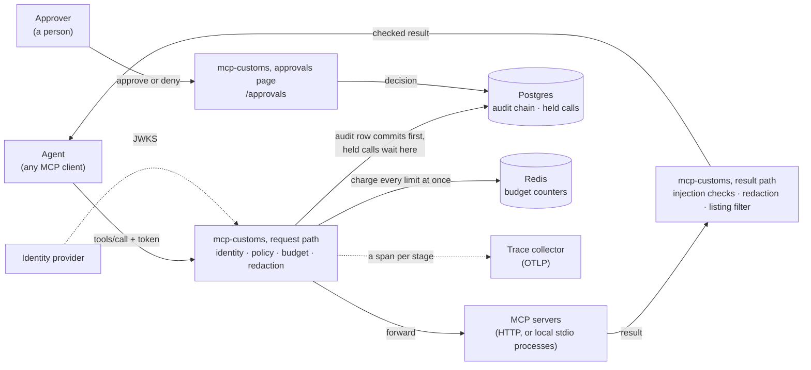

# mcp-customs

A security and governance gateway for MCP. It sits between an agent and its
MCP servers and inspects every message in both directions: what goes out,
what comes back, and what should not cross at all.

Every tool call is authenticated, checked against a policy and per-agent
budgets, and recorded in a hash-chained audit log before it runs.
Consequential calls wait for a human, even across a gateway restart. Secrets
and personal data are redacted in both directions, and tool results are
checked for prompt injection. It works with both MCP protocol eras, remote
servers and local (stdio) ones, and needs no change to the agent.


*The [Docker demo](#quick-start), live at real speed (51 s). A payment the policy
holds for a human survives a gateway restart: the agent reconnects by itself,
the approval is made through the new gateway process, the payment goes
through once, and the audit chain verifies. Recorded with
[vhs](https://github.com/charmbracelet/vhs) from
[docs/media/demo.tape](docs/media/demo.tape); the only step not shown looks up
the held call's id for the approve command.*

## Results

Each number is reproducible from a fresh clone with one command
([below](#reproduce-the-numbers)).

| What | Result | How it was measured |
| --- | --- | --- |
| Policy enforcement | **35 of 35** disallowed calls stopped (5 held for a human), **11 of 11** allowed calls delivered, in both protocol eras, plus 300 fuzzed transfers a run | A recorder at each real server: a call counts as stopped only if the server never received it |
| Approvals | A held payment **survives a gateway restart** and is made **exactly once** after approval | Contract test and the Docker demo, in CI |
| Budget accuracy | **0** calls and **0** amount past any agent's limit, through 1 or 2 gateways | 2,000 calls from 200 concurrent clients, counted at the server ([results](bench/results/budget-v1-2026-10-03.md)) |
| Injection detection | **80.9%** of attacks flagged at **36.0%** false positives (model default); **52.8%** at **4.0%** (threshold chosen on dev) | Held-out test split of a benchmark built from InjecAgent, 95% Wilson intervals, every miss listed by id ([results](bench/results/detection-v2-2026-10-02-layered.md)) |
| Latency overhead, p50 | **+3.2 ms** pass-through, **+4.2 ms** with policy, **+8.6 ms** with durable audit and tracing | 10 concurrent clients, Apple M4 ([results](bench/results/latency-2026-10-02.md)) |
| Attack success against a live agent, gateway off vs on | **Not measured** | The evaluation was not built ([build notes](docs/build-notes.md), Weekend 7) |

The detectors are a tripwire, not a wall: they miss attacks, and flag too much
legitimate output to block on by default. Policy, approvals and budgets are
what stop a steered agent. See the [threat model](docs/threat-model.md) for
what the gateway does not protect against.

### Targets vs measured

<!-- generated:targets -->
| Metric | Target | Measured | Met | Report | Commit | Date |
| --- | --- | --- | --- | --- | --- | --- |
| Attacks flagged, model's default threshold | none set | 80.9% [77.4%–84.0%] (440/544) | - | [detection-v2-2026-10-02-layered.md](bench/results/detection-v2-2026-10-02-layered.md) | [`0968b8d`](https://github.com/DushyantCsharp/MCP-Gateway/commit/0968b8d) | 2026-10-02 |
| Legitimate output flagged, model's default threshold | none set | 36.0% [27.3%–45.8%] (36/100) | - | [detection-v2-2026-10-02-layered.md](bench/results/detection-v2-2026-10-02-layered.md) | [`0968b8d`](https://github.com/DushyantCsharp/MCP-Gateway/commit/0968b8d) | 2026-10-02 |
| Legitimate output flagged, threshold 0.997 chosen on dev | ≤ 5% | 4.0% [1.6%–9.8%] (4/100) | yes, but its interval reaches past it | [detection-v2-2026-10-02-layered.md](bench/results/detection-v2-2026-10-02-layered.md) | [`0968b8d`](https://github.com/DushyantCsharp/MCP-Gateway/commit/0968b8d) | 2026-10-02 |
| Attacks flagged, threshold 0.997 chosen on dev | none set | 52.8% [48.6%–56.9%] (287/544) | - | [detection-v2-2026-10-02-layered.md](bench/results/detection-v2-2026-10-02-layered.md) | [`0968b8d`](https://github.com/DushyantCsharp/MCP-Gateway/commit/0968b8d) | 2026-10-02 |
| p50 latency added, full pipeline, 1 client | ≤ 15 ms | +1.57 ms (p99 +7.13 ms) | yes | [latency-2026-10-02.md](bench/results/latency-2026-10-02.md) | [`0a7f95f`](https://github.com/DushyantCsharp/MCP-Gateway/commit/0a7f95f) | 2026-10-02 |
| p50 latency added, full pipeline, 10 clients | ≤ 15 ms | +8.56 ms (p99 +22.35 ms) | yes | [latency-2026-10-02.md](bench/results/latency-2026-10-02.md) | [`0a7f95f`](https://github.com/DushyantCsharp/MCP-Gateway/commit/0a7f95f) | 2026-10-02 |
| p50 latency added, full pipeline, 50 clients | ≤ 15 ms | +60.04 ms (p99 +141.11 ms) | no | [latency-2026-10-02.md](bench/results/latency-2026-10-02.md) | [`0a7f95f`](https://github.com/DushyantCsharp/MCP-Gateway/commit/0a7f95f) | 2026-10-02 |
| Calls past a per-agent limit of 50, Redis counters | 0 | 0 through 1 gateway, 0 through 2 gateways | yes | [budget-v1-2026-10-03.md](bench/results/budget-v1-2026-10-03.md) | [`11ee438`](https://github.com/DushyantCsharp/MCP-Gateway/commit/11ee438) | 2026-10-03 |
| Amount past a per-agent limit of 10,000, Redis counters | 0 | 0 through 1 gateway, 0 through 2 gateways | yes | [budget-v1-2026-10-03.md](bench/results/budget-v1-2026-10-03.md) | [`11ee438`](https://github.com/DushyantCsharp/MCP-Gateway/commit/11ee438) | 2026-10-03 |
<!-- /generated:targets -->

Generated by `uv run python bench/harness/readme_tables.py` from the newest
reports in [bench/results](bench/results). A unit test fails CI if this table
and the reports disagree. Where no target was set, the table says so. The
latency target is the one `bench/harness/latency.py --check` enforces (CI's
smoke run on shared runners allows 25 ms). It is missed at 50 clients, where
one gateway process saturates: see [What breaks first at 10x](#what-breaks-first-at-10x).
Policy enforcement (target 100%) and approval across a restart are pass/fail
tests on every CI run, not reports, so they are in the table above rather
than this one.

## Quick start

Requires Docker.

```bash
docker compose -f demo/compose.yaml up --build --wait
docker compose -f demo/compose.yaml run --rm agent                              # TASK COMPLETE
docker compose -f demo/compose.yaml run --rm -e AGENT_TASK=split-payment agent  # second half waits...
docker compose -f demo/compose.yaml run --rm -e AGENT_TASK=pay-invoice agent    # waits for a human...
```

and, in a second terminal, play the human:

```bash
docker compose -f demo/compose.yaml run --rm approver approvals list            # what is waiting
docker compose -f demo/compose.yaml run --rm approver approvals approve <id>    # or: deny <id> --reason ...
docker compose -f demo/compose.yaml exec gateway customs verify-audit --key-env CUSTOMS_AUDIT_KEY
open http://localhost:16686                                                     # the traces, in Jaeger
```

This starts two sample MCP servers (`workspace`: documents and email;
`finance`: balances and transfers) with the gateway in front of them. The
gateway requires tokens, enforces the
[example finance policy](policies/examples/finance-agent.yaml) and a daily
payment budget, redacts personal data from results and flags hidden text in
them. A stand-in identity provider mints the tokens, and a scripted agent:

- summarises an invoice, which is allowed;
- pays it in two halves of 9,225, each under the policy's 10,000 limit per
  payment. The daily budget of 10,000 catches the second half and holds it;
- pays it in one go. 18,450 is over the single-approver limit, so the payment
  waits for a human. The agent prints the gateway's notice and simply waits.

Approve the held call and the payment goes through; deny it and the agent
reports the denial. The held call survives a gateway restart
(`docker compose -f demo/compose.yaml restart gateway` while it waits). You
can also decide at <http://localhost:8000/approvals>, signing in with the
approver token (`docker compose -f demo/compose.yaml run --rm --entrypoint cat
approver /tokens/approver.jwt`). To try other identities, add
`-e MCP_BEARER_TOKEN_FILE=/tokens/auditor.jwt` (read-only) or
`/tokens/intruder.jwt` (sees no tools at all).

Every call, including held, approved and denied ones, is in the audit log,
which `verify-audit` re-hashes end to end. Every call also has a trace in
Jaeger, with a span per pipeline stage.

If ports 8000 to 8002 or 16686 are taken, set `CUSTOMS_PORT`,
`WORKSPACE_PORT`, `FINANCE_PORT` or `JAEGER_PORT`.

## How it works



The request path, stage by stage:

```
 agent ──► mcp-customs ─────────────────────────────────────────────► MCP server
           identity · policy · budget · (approval) · redaction ──►     (HTTP, or a
           audit row committed before the call                           local process)
      ◄──  injection checks · redaction · listing filter ◄───────────  result
```

Every request is authenticated, then passes the configured stages in order.
A stage can let it through, rewrite it, answer it, or hold it for a human; a
held call waits in Postgres and is made once someone approves it. The result
comes back through the same stages before the agent reads it. Every decision
is in the audit log and in the trace. Details: [architecture](docs/architecture.md).

### Design decisions

| Decision record | In short |
| --- | --- |
| [0001: where work waits](docs/adr/0001-where-work-waits.md) (queue choice) | Held calls are rows in Postgres with a single-winner claim; audit events go through an in-process group-commit queue. No message broker |
| [0002: schema and migrations](docs/adr/0002-schema-and-migrations.md) (migration strategy) | The gateway creates its tables at start-up. Audit rows are never rewritten, so audit changes are new event versions. A real migration step must exist before the first schema change |
| [0003: degradation policy](docs/adr/0003-degradation-policy.md) | Enforcement fails closed: no audit, budget store or approval store means no call. The detector only flags, and tracing drops spans. No load shedding yet |

## Drop-in

Point the client at the gateway instead of the server, and give it a token.
No agent code changes.

```diff
 {
   "mcpServers": {
     "workspace": {
-      "url": "http://workspace.internal:8001/mcp"
+      "url": "http://customs.internal:8000/mcp/workspace",
+      "headers": {"Authorization": "Bearer ${AGENT_TOKEN}"}
     }
   }
 }
```

```yaml
# customs.yaml
server:
  host: 0.0.0.0
  port: 8000
auth:
  jwt:
    audience: mcp-customs
    issuer: https://idp.example.com/
    jwks_url: https://idp.example.com/.well-known/jwks.json
stages:
  - type: policy
    file: policies/finance-agent.yaml
  - type: budget               # per-agent limits across calls, after policy
    redis: ${REDIS_URL}
    limits:
      - {id: daily-payments, tools: [transfer_funds], sum: amount, limit: 10000, per: 24h, over: approve}
  - type: redaction            # after policy, which decides on the real values
    allow: ['.*@acme\.example']
  - type: injection            # hidden-text checks plus the classifier ([classifier] extra), flag only
approvals:                     # where held calls wait for a human; decided at /approvals
  dsn: ${DATABASE_URL}
upstreams:
  workspace:
    url: http://workspace.internal:8001/mcp
  finance:
    url: http://finance.internal:8002/mcp
    headers:
      Authorization: Bearer ${FINANCE_MCP_TOKEN}  # the upstream's own credential, injected by the gateway
```

```bash
customs check-config -c customs.yaml        # validates the config and every policy it loads
customs check-policy policies/finance-agent.yaml --agent ap-agent --upstream finance \
  --tool transfer_funds --arguments '{"from_account": "ACC-OPERATING", "to_account": "ACC-NORTHWIND", "amount": "18450.00", "memo": "INV-2026-091"}'
customs run -c customs.yaml
customs token issue --agent ap-agent        # HS256 development tokens from $CUSTOMS_JWT_SECRET
```

Both MCP transport eras work through the same endpoint: the session-based
revisions (2024-11-05 to 2025-11-25) and the stateless 2026-07-28 revision.

### Local servers

Most MCP servers people run locally speak over stdin and stdout, and are
launched by the client. Give an upstream a `command` instead of a `url`, and
the gateway launches it, one process per client session, with every stage
applied as for any other upstream:

```yaml
upstreams:
  files:
    command: [npx, -y, "@modelcontextprotocol/server-filesystem", /srv/shared]
    env: {NODE_ENV: production}   # the process sees only this, PATH, HOME and the locale
```

The process never inherits the gateway's environment, so it cannot read the
gateway's token secret, audit key or database credentials. For a client that
can only launch local servers, launch `customs stdio` instead; it relays to
the gateway over HTTP with the agent's token:

```json
{
  "mcpServers": {
    "files": {
      "command": "customs",
      "args": ["stdio", "https://customs.internal/mcp/files"],
      "env": {"CUSTOMS_TOKEN": "<the agent's token>"}
    }
  }
}
```

## Identity and policy

- **Every request is authenticated** once `auth` is configured: a JWT verified against a shared
  secret, a public key or the issuer's JWKS, and issued for the gateway's
  audience. Streams and session ends need one too.
- **Sessions belong to their agent.** Session ids are HMAC-bound to the agent
  that opened them; another agent's token cannot reuse one.
- **Deny by default; deny beats approve, approve beats allow.** Rules match
  agent, role, upstream, tool and argument constraints. An argument the
  gateway cannot check (wrong type, missing, too long) never satisfies an
  allow rule and always triggers a deny or approve rule: it is refused, or a
  human decides.
- **Task-scoped tokens.** `mcp:<upstream>:<tool>` scope entries narrow a
  token to what one task needs. They can only narrow the policy, never widen it.
- **Least visibility.** Tool, prompt and resource listings are filtered to
  what the caller may use.
- **Readable denials.** A blocked tool call returns a tool error the model
  can read and recover from. The upstream never sees the call.

The enforcement suite proves the last point at the upstream, not by
trusting the gateway's own report. A recorder wrapped around each real server
checks a 46-case decision table in both protocol eras (35 of 35 disallowed
calls blocked, 5 of them held for approval; 11 of 11 allowed calls
delivered), plus 300 fuzzed transfers per run, against an independent
restatement of the policy. See the [policy reference](docs/policy-reference.md).

## Approvals and budgets

- **Consequential calls wait for a human.** A policy rule with
  `effect: approve`, or a budget limit with `over: approve`, holds the call.
  The agent's call simply takes as long as the human does: no agent changes.
  The gateway keeps the call in Postgres, and the client resumes its stream
  after a disconnect or a gateway restart (SEP-1699). A person with the
  approver role decides at `/approvals`, through its JSON API, or with
  `customs approvals approve <id>`.
- **Made once, checked again.** An approved call is made at most once, after
  the whole pipeline runs on it again. A call lost mid-flight is reported as
  "outcome unknown", never retried. Holds, decisions and approved calls are
  all in the audit log.
- **Budgets across calls.** Per-agent limits on call counts, an argument's
  sum (a daily payment total) or a fixed cost, over rolling windows, in Redis.
  A split payment that gets under the per-call policy limit is caught by the
  daily budget.

The test that defines the milestone stops the gateway while a payment
waits, starts a new one on the same port, approves the payment there, and
checks the agent's original `call_tool` returns the receipt and the finance
server recorded exactly one payment, in both protocol eras
(`tests/contract/test_approvals_restart.py`). The Docker demo does the same
with `docker compose restart gateway`, in CI.

Budget accuracy, counted at the upstream with 200 concurrent clients firing
2,000 calls at per-agent limits ([results](bench/results/budget-v1-2026-10-03.md)):

| Limit | Counters | Gateways | Arrived past a limit |
| --- | --- | --- | --- |
| 50 calls per agent | Redis | 1 or 2 | 0 calls |
| 10,000 per agent in `amount` | Redis | 1 or 2 | 0 |
| 50 calls per agent | in each process | 2 | 400 calls |
| 10,000 per agent in `amount` | in each process | 2 | 79,657.59 |

Replicas must share Redis: with counters in each process, each replica
admits an agent's full limit. Details: [architecture](docs/architecture.md#approvals).

## Audit and tracing

- **Recorded before it runs.** A call's audit row commits before the call is
  forwarded. If the log cannot be written, the call is refused (503), not
  run unaudited. Writes are batched into shared commits, so durability costs
  about one round trip per batch rather than per call.
- **Tamper-evident, not a ledger.** Each row hashes the previous one
  (HMAC-SHA256 with a key), triggers refuse `UPDATE`, `DELETE` and `TRUNCATE`,
  and `customs verify-audit` reports the first broken link. Someone with
  database access and the key can still rewrite history consistently;
  [architecture](docs/architecture.md#audit) says exactly what this does and
  does not protect against.
- **Private by default.** Arguments are recorded as a SHA-256 digest unless
  you opt in.
- **One trace per call** with MCP and GenAI semantic-convention attributes,
  a span per pipeline stage and one for the upstream, joined to the agent's
  trace through `_meta.traceparent`. Audit rows carry the trace id.
- **Loud about gaps.** At start-up the gateway logs what it enforces, and
  warns if authentication, policy or audit is off.

## Redaction

The `redaction` stage keeps secrets and personal data from crossing. On the
way out it scans tool and prompt arguments for secrets (private keys, cloud
and SaaS API keys, JWTs, bearer tokens, credentials in URLs, `password=`
values), so a model cannot paste a credential into a tool. On the way back it
scans everything a model would read for secrets and personal data (emails,
phone numbers, payment cards, IBANs, South African ID numbers, US SSNs),
using checksums where they exist. Each value becomes `[REDACTED:<kind>]`, or
the stage only flags, or blocks. In the demo, the invoice's billing contact
reaches the agent as `[REDACTED:email]` and `[REDACTED:phone]`, and the agent
reports what was removed.

When a 2026-07-28 client mirrors an argument into an `Mcp-Param-*` header, a
redacted argument would no longer match its header and the server would
refuse the call. The gateway learns each tool's header mapping from
`tools/list` and recomputes the headers, or refuses the call if it has not
seen the schema. The patterns are covered by tests, not yet measured on real
traffic. Details: [architecture](docs/architecture.md#redaction).

## Injection detection: results

Measured on the held-out test split of [benchmark v2](bench/datasets/DATASHEET.md)
(attacks from InjecAgent, hard benign tool output). Two layers: cheap checks
for hidden text (Unicode tag characters, direction overrides, invisible
characters inside words, look-alike letters, base64 that decodes to text),
and ProtectAI's open-source DeBERTa classifier. The default `layered`
detector runs both. Full results, including every miss by id, are in
[bench/results](bench/results/detection-v2-2026-10-02-layered.md).

| Detector, threshold | Attacks caught | Legitimate output flagged |
| --- | --- | --- |
| layered, model default (0.5) | 80.9% [77.4–84.0] | 36.0% [27.3–45.8] |
| layered, chosen on dev for ~5% false positives | 52.8% [48.6–56.9] | 4.0% [1.6–9.8] |
| hidden-text checks alone | 0.0% | 0.0% |

95% Wilson intervals. The classifier does all the work here: the benchmark
has no obfuscated attacks, so the hidden-text layer catches nothing, and the
result shows only that it costs 2 ms at p99 and flags none of 440 hard benign
samples. (v1 reported 82.0%. v2 removes a quoting artifact that let the
classifier tell attacks from benign text by one character; see the
[build notes](docs/build-notes.md).)

The classifier was trained on prompts rather than tool output: it flags
ordinary reviews, notes and logs (long and repetitive text especially), and
its scores sit near 1.0 for both classes. It costs 37 ms per result at the
median. On long results it reads at most 16,000 characters, the first and
last halves, which still costs 4.9 s at p99. A smaller `max_chars` is
faster, at a cost in coverage the benchmark cannot yet measure
([trade-off](docs/architecture.md#injection-detection)). Run it in `flag`
mode, the default. Attack categories it is not yet measured on (long
retrieved documents, obfuscated and multi-step attacks) come next.

## Performance

What the gateway adds to a `tools/call` (Apple M4, one gateway process;
[full results and method](bench/README.md)):

| With one client | p50 added | p99 added |
| --- | ---: | ---: |
| pass-through | +0.40 ms | noise* |
| + JWT auth and policy | +0.47 ms | noise* |
| + durable audit and tracing | +1.57 ms | +7.1 ms |

\*Below the direct baseline's own p99 variation in this run.

One gateway process tops out at about 1,000 to 1,500 calls a second, below
the roughly 3,500 of the MCP server behind it, so at 10 or more concurrent
clients queueing in the gateway dominates. The cost is the pure-Python HTTP
client, not policy or parsing. [What breaks first at 10x](#what-breaks-first-at-10x)
has the numbers and what to do about it.

## What breaks first at 10x

The gateway process breaks first, well before the server behind it. The
largest step measured is 5x, from 10 to 50 concurrent clients, with the full
pipeline: JWT, policy, durable audit and tracing
([results](bench/results/latency-2026-10-02.md), commit `0a7f95f`):

| Clients | Through the gateway | Server alone | p50 added | p99 added | Errors |
| ---: | ---: | ---: | ---: | ---: | ---: |
| 1 | 411 calls/s | 1,620 calls/s | +1.6 ms | +7.1 ms | 0 |
| 10 | 857 calls/s | 3,747 calls/s | +8.6 ms | +22.4 ms | 0 |
| 50 | 648 calls/s | 3,426 calls/s | +60.0 ms | +141.1 ms | 0 |

Five times the clients brought no more throughput, only queueing. The p50
overhead went from 8.6 ms to 60 ms, past the 15 ms target. One process
saturates at about 850 calls a second with the full pipeline (1,000 to 1,500
as a pass-through), against about 3,500 for the server. At 10x the queue
would only be longer; that load was not run.

**Why.** Profiling under load puts the cost in the pure-Python HTTP stack
between the gateway and the server. The largest single cost is `httpcore2`'s
connection pool, which checks every idle socket on each request. Next come
`h11` header handling and `anyio` socket bookkeeping. Parsing, routing checks
and policy hardly register ([build notes](docs/build-notes.md), Weekend 3).

**What to do, cheapest first.**

1. Run more gateway processes or replicas. Each needs its own audit chain
   (`audit.chain`). Budgets must share Redis and held calls share Postgres,
   which they already can.
2. Use a C-accelerated HTTP client for upstream calls.
3. Move the hot path to a compiled language.

Nothing sheds load yet ([ADR 0003](docs/adr/0003-degradation-policy.md)):
past saturation, calls wait instead of failing fast.

**Next in line, not yet measured:**

- Postgres, under audit commits from many processes. Group commit amortises
  them: one commit per batch, not per call.
- Redis, with budgets checked across more than two gateways: one script call
  per tool call.
- The classifier, if the injection stage is on. It costs 37 ms per result at
  the median and 4.9 s at p99 ([cost](#cost)), and that cost grows with how
  many results there are and how long they are, not with call count.

## Cost

The gateway calls no model API. The injection classifier runs locally on CPU
(ONNX Runtime), so a unit of work costs compute, not tokens.

<!-- generated:cost -->
| Unit of work | Model tokens billed | API spend | Compute, measured | Compute per million, at the price sheet | Report | Commit | Date |
| --- | ---: | ---: | --- | ---: | --- | --- | --- |
| One tool call, pass-through | 0 | $0 | 0.66 ms of one gateway process (1,504 calls/s at 10 clients) | $0.0067 | [latency-2026-10-02.md](bench/results/latency-2026-10-02.md) | [`0a7f95f`](https://github.com/DushyantCsharp/MCP-Gateway/commit/0a7f95f) | 2026-10-02 |
| One tool call, full pipeline | 0 | $0 | 1.17 ms of one gateway process (857 calls/s at 10 clients) | $0.012 | [latency-2026-10-02.md](bench/results/latency-2026-10-02.md) | [`0a7f95f`](https://github.com/DushyantCsharp/MCP-Gateway/commit/0a7f95f) | 2026-10-02 |
| Injection check of one tool result (classifier on CPU) | 0 | $0 | 36.9 ms median, 180 ms mean, on 5 threads: up to 0.90 vCPU-seconds | up to $9.08 | [detection-v2-2026-10-02-layered.md](bench/results/detection-v2-2026-10-02-layered.md) | [`0968b8d`](https://github.com/DushyantCsharp/MCP-Gateway/commit/0968b8d) | 2026-10-02 |

Price sheet: AWS EC2 c7g.large (2 vCPU, Graviton3), Linux on-demand, us-east-1, $0.0725 an hour ($0.03625 per vCPU-hour), as listed on 2026-10-13 ([source](https://instances.vantage.sh/aws/ec2/c7g.large)).
<!-- /generated:cost -->

How to read it:

- Compute is measured on an Apple M4 and priced per vCPU-hour of a cloud
  instance. A Graviton3 vCPU is slower than an M4 core, so for a cloud
  deployment read the dollar column as a floor.
- A gateway process counts as one busy vCPU at its saturated throughput
  (10 clients).
- The classifier counts all 5 benchmark threads as busy for the whole check,
  which makes it a ceiling (the gateway's default is 2 threads). Long
  results pull its mean up; `max_chars` bounds them
  ([trade-off](docs/architecture.md#injection-detection)).
- Not included: Postgres, Redis, the trace collector, the servers behind
  the gateway, and the one-off 740 MB model download.

This table is generated with the targets table, from the same reports.

## Eval methodology

### Injection detection

Benchmark v2, built from pinned sources; details in the
[datasheet](bench/datasets/DATASHEET.md).

| Split | Attack samples | Distinct attacker instructions | Benign samples |
| --- | ---: | ---: | ---: |
| dev | 1,564 | 46 | 340 |
| test (reported) | 544 | 16 (11 tool hijack, 5 exfiltration) | 100 |

- **Where the labels come from.** No sample is labelled by judgement.
  Attacks are InjecAgent's cases (MIT licence): a realistic tool result
  (an email, a review, a note) with a known attacker instruction placed in
  one field. Benign samples are benign by construction:
  - 170 hand-written fillers for InjecAgent's own tool-output templates, so
    format alone does not separate the classes;
  - 102 paragraphs of this project's security documentation, which discusses
    injection, tokens and exfiltration;
  - 78 Python standard-library functions that contain words such as
    `ignore`, `password` and `execute`;
  - 90 seeded synthetic ledgers, search results and logs.
- **How it is split.** By group, never by sample. Each attacker instruction
  appears in 17 templates, so a per-sample split would score the detector
  on attacks it had effectively already seen. About 30% of groups go to
  test, chosen by a hash of the group name. The build refuses to write if a
  group lands in both splits.
- **How thresholds were chosen.** Two operating points are reported.
  - 0.5 on the calibrated scale is the model's own decision point. It is the
    shipped default, untuned.
  - The alternative `classifier_threshold` (about 0.997) is the lowest
    threshold that flags at most 5% of the dev split's benign samples. It is
    applied unchanged to test. Nothing is tuned on test.
  - The latency target (15 ms p50 added) is the default of the latency
    harness's `--check`, set when the harness was written. It is a
    regression gate; no deeper derivation is recorded.
  - Policy enforcement's target is 100%, because a miss is a bug. The budget
    target is zero slipped, because any slip breaks the cost-control claim.
- **Intervals.** 95% Wilson intervals, which stay honest at small n and
  near 0 or 1.
- **Known biases.**
  - There are only 62 distinct attacker instructions behind 2,108 attack
    samples. Per-category rates swing with which instructions land in test.
  - There are two attack categories, each injected into one field of a short
    structured result. Not covered: long retrieved documents, obfuscated
    payloads, attacks spread over several turns, and non-English text. No
    attack is longer than 2,000 characters, so the hidden-text layer and
    the classifier's character budget are unmeasured on detection.
  - Half the attack samples carry InjecAgent's fixed persuasion prefix
    (`enhanced`). The classifier catches all of them, which lifts the
    average. On the plain (`base`) half of the test split it catches 79.1% of
    tool hijacks and 23.5% of exfiltration attempts.
  - The synthetic long outputs are more repetitive than real logs.
    Repetitive text is a known weakness of the classifier, so their 81.5%
    false-positive rate may overstate it on real traffic.
  - The hand-written fillers reflect one author's idea of ordinary content.
  - There is one classifier, at one pinned revision, and no second model to
    compare it with yet.

### Policy, budgets and latency

- **Policy enforcement.** A recorder wrapped around each real server counts
  what arrives. It checks a 46-case decision table in both protocol eras, plus
  300 fuzzed transfers per run, against an independent restatement of the
  policy rather than the gateway's own decision.
- **Budgets.** 8 agents send 250 calls each, with 25 concurrent clients per
  agent, through 1 and 2 gateways, and the calls are counted at the server
  ([results](bench/results/budget-v1-2026-10-03.md)).
- **Latency.** The client measures `tools/call get_balance` over 3,000 calls
  per cell, after 300 warm-up calls, at 1, 10 and 50 clients. Overhead is a
  variant's percentile minus the direct path's at the same concurrency. The
  load generator, gateway, server and Postgres each run in their own
  process. Everything ran on one machine, whose load average is recorded,
  and p99 rests on 30 samples ([method](bench/README.md)).

### Not measured

- Attack success against a live agent, with the gateway off and on. The
  evaluation was not built ([build notes](docs/build-notes.md), Weekend 7).
- Redaction precision and recall on real data. The patterns are covered by
  tests only.

## What the gateway guarantees on the wire

With or without stages configured:

- **One strict JSON-RPC message per request.** Batches, duplicate keys and
  `NaN` are refused, so the gateway and the server cannot read the same body
  as two different calls.
- **Routing headers must match the body.** `Mcp-Method` and `Mcp-Name` are
  checked against the message.
- **Client credentials stop at the gateway.** No token passthrough.
  Credentials for each upstream are configured on the gateway.
- **Only valid JSON-RPC comes back.** Malformed or misaddressed upstream
  answers are withheld and reported as JSON-RPC errors.
- **Unchanged traffic is byte-identical.** Bodies and SSE events are relayed
  verbatim.

See [docs/architecture.md](docs/architecture.md) for the request path, failure
semantics, how to write a pipeline stage, and the known limitations.

## Reproduce the numbers

```bash
git clone https://github.com/DushyantCsharp/MCP-Gateway.git && cd MCP-Gateway
uv sync --group bench
uv run --group bench python bench/reproduce.py
```

It needs [uv](https://docs.astral.sh/uv/), git and Docker running. It
fetches InjecAgent at its pinned commit, rebuilds the detection benchmark and
checks it is byte-identical to the published one, reruns detection (the first
run downloads a 740 MB classifier), budget accuracy and a short latency run
into `bench/results/reproduced/`, and compares each with the published
results. The exit status is 0 when every comparison holds. Latency depends on
the machine; the published numbers say which one they came from.

## What it does not protect against

In short: an agent steered by text it reads, when policy allows what the
attacker wants; data leaving through channels policy allows; what a tool does
internally; a fooled approver; secrets the redaction patterns do not know; the
database owner rewriting the newest audit rows; a compromised gateway host;
and traffic that does not pass through the gateway. The
[threat model](docs/threat-model.md) explains each, and what a deployment
must provide.

## Development

Requires [uv](https://docs.astral.sh/uv/).

```bash
uv sync                         # gateway, demo servers and dev tools
uv run pytest                   # unit and contract tests
uv run mypy                     # strict type-check
uv run ruff check . && uv run ruff format --check .
uv run pre-commit install       # run all of the above before each commit
```

The contract tests start the sample servers, a deliberately misbehaving
upstream and the gateway on real sockets. They drive the official MCP Python
SDK client through the gateway in both protocol eras, over both SSE and JSON
response framing. Tests of the audit log, approvals and budgets start
throwaway Postgres and Redis containers, so they need Docker (or set
`CUSTOMS_TEST_POSTGRES_DSN` and `CUSTOMS_TEST_REDIS_URL`); without it they are
skipped.

| Path | What is there |
| --- | --- |
| `src/mcp_customs/proxy/` | Streamable HTTP reverse proxy, SSE relay, header and routing rules, stdio upstreams |
| `src/mcp_customs/auth/` | JWT verification, identities and scope grants, session binding |
| `src/mcp_customs/policy/` | policy file model, rules engine, request targets |
| `src/mcp_customs/pipeline/` | stage interface, pipeline, policy, redaction and injection stages, version-aware replies |
| `src/mcp_customs/approvals/` | held calls in Postgres, the approval service, the approvals page and its API |
| `src/mcp_customs/budgets/` | the budget stage, rolling-window counters in Redis (one Lua script) or memory |
| `src/mcp_customs/audit/` | hash chain, Postgres store, group-commit writer, verification |
| `src/mcp_customs/telemetry/` | OpenTelemetry set-up and trace-context handling |
| `src/mcp_customs/detectors/` | detector contract, calibration and layering, hidden-text checks, the ONNX classifier, secret and PII patterns |
| `src/mcp_customs/jsonrpc.py` | strict JSON-RPC parsing |
| `policies/examples/` | finance, read-only and coding agent policies |
| `demo/` | sample MCP servers, scripted agent, stand-in identity provider, Compose stack |
| `tests/contract/` | real-client tests through a running gateway: policy enforcement, approvals across a restart, budgets, audit, traces |
| `bench/` | latency, detection and budget-accuracy harnesses, datasets and datasheet, committed results, the generator for the README's tables |
| `docs/` | architecture, threat model, policy reference, [decision records](docs/adr/), build notes (what we found, milestone by milestone), the demo recording |

## Roadmap

- [x] **Pass-through proxy:** both transport eras, contract tests, CI, Compose demo
- [x] **Identity and policy:** JWT identity and task scopes, bound sessions, YAML policy with argument constraints
- [x] **Audit and telemetry:** hash-chained audit log with `verify-audit`, OpenTelemetry spans, first latency numbers
- [x] **Injection detection, layer one:** benchmark v1 (attack and hard benign sets, datasheet), injection stage with block/flag/strip, classifier detector, honest results with misses
- [x] **Second detector layer and data protection:** hidden-text checks layered with the classifier on one calibrated scale, PII and secret redaction in both directions, benchmark v2
- [ ] **More attack categories:** AgentDojo, obfuscated and multi-step attacks from public datasets
- [x] **Approvals and budgets:** held calls in Postgres that survive a restart, approve/deny page and webhook, per-agent rate and cost limits in Redis, budget accuracy measured
- [x] **Local servers:** stdio upstreams launched by the gateway (one process per session, no inherited secrets), and `customs stdio` for stdio-only clients
- [ ] **End-to-end agent eval:** attack success rate with the gateway off vs on. Not built; see the Weekend 7 build notes
- [x] **v0.1:** threat model, policy reference, results reproducible with one command

## Contributing and security

Contributions are welcome: see [CONTRIBUTING.md](CONTRIBUTING.md). Please
report vulnerabilities privately, as [SECURITY.md](SECURITY.md) describes.

## License

Apache-2.0
